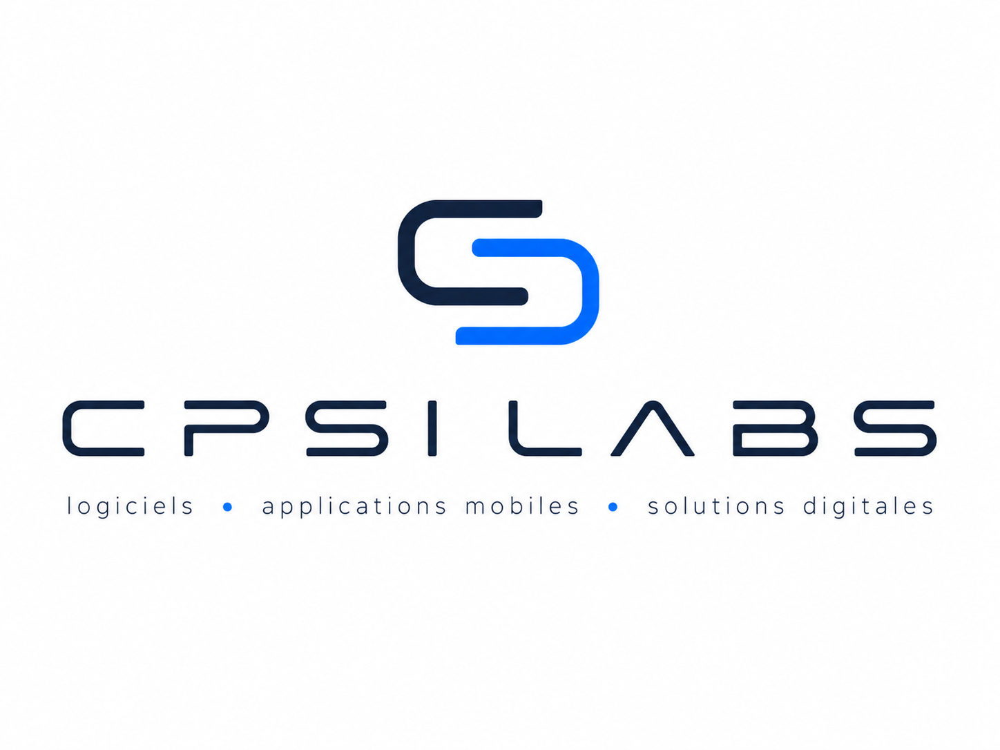
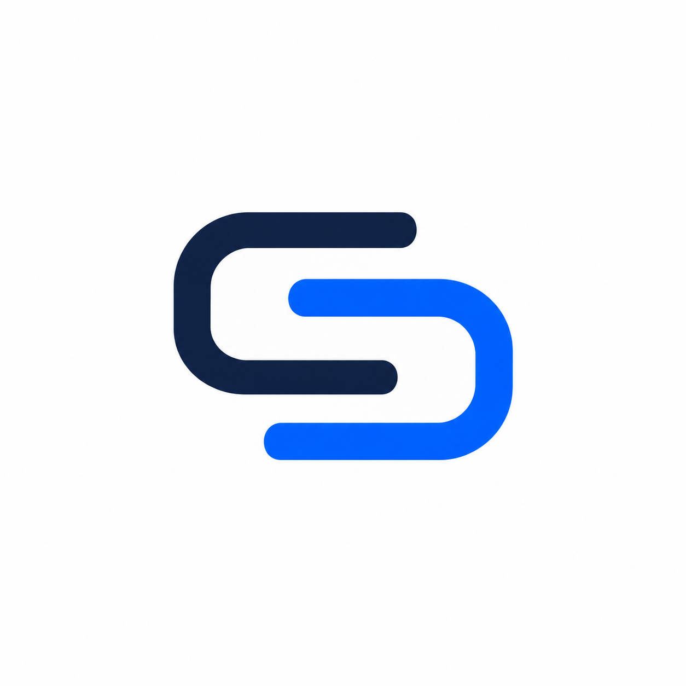

<picture>
  <source media="(prefers-color-scheme: dark)" srcset="https://raw.githubusercontent.com/cpsi-labs/cpsi-labs/main/assets/logo-dark.png">
  <source media="(prefers-color-scheme: light)" srcset="https://raw.githubusercontent.com/cpsi-labs/cpsi-labs/main/assets/logo-light.png">
  
</picture>

### BUILD. INNOVATE. EVOLVE.

**Independent Software Development & Innovation Lab**

*Engineering technology without boundaries.*

---

## About Us

CPSI LABS is an independent software development initiative
focused on creating reliable, innovative and accessible
digital solutions.

Our mission is to build practical technology that simplifies
everyday challenges, improves productivity and empowers users.

## What We Build

| Domain | Solutions |
| :--- | :--- |
| Mobile Applications | Android and cross-platform apps |
| Desktop Software | Linux and Windows applications |
| Networking | Network management and infrastructure tools |
| Cybersecurity | Privacy and security-focused utilities |
| Web Development | Modern web applications and APIs |
| Automation | Scripts, system tools and workflow automation |

## Technology Stack

## Featured Projects

Our first software projects are currently in development.

Stay tuned for upcoming applications, tools and releases.

## Downloads & Releases

All publicly available applications and their releases
will be accessible through our GitHub repositories.

[Explore our repositories](https://github.com/cpsi-labs?tab=repositories)

## Our Principles

- Reliability and performance
- Privacy by design
- Clean and maintainable software
- Continuous learning and innovation
- Accessible technology

---

**CPSI LABS © 2026**

*Independent by design. Innovative by purpose.*

